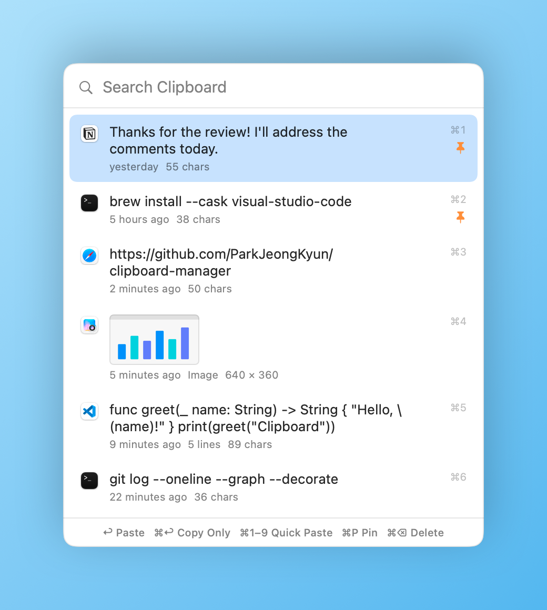

# Clipboard Manager — Win+V for Mac

[](https://github.com/ParkJeongKyun/clipboard-manager/releases/latest)

[](LICENSE)

Coming from Windows and missing `Win + V`? This is a free, open-source clipboard history for the Mac menu bar.
Press `⌃⌘V`, pick something you copied earlier with the keyboard, and it is pasted straight into the app you were using.

> 윈도우의 `Win + V`처럼 쓰는 맥용 클립보드 기록 앱입니다. 무료·오픈소스이고, 한국어 화면과 한글 입력을 지원합니다.

```sh
curl -fsSL https://raw.githubusercontent.com/ParkJeongKyun/clipboard-manager/main/install.sh | bash
```

<p align="center">
  <picture>
    <source media="(prefers-color-scheme: dark)" srcset="docs/images/quick-picker-dark.png">
    
  </picture>
</p>

## Why this one?

- **Works like Windows' clipboard history**: a small picker at your pointer, recent text and images, pinned items first, `↩` to paste. No new habits to learn.
- **Keyboard first, never steals focus**: the picker doesn't activate the app, so pasting lands exactly where you were typing.
- **Private by design**: no account, no analytics, no cloud. History is encrypted on your Mac, password managers are ignored, and screenshots aren't kept on disk unless you pin them.
- **Small and native**: Swift/SwiftUI, a few MB, no Electron. English and Korean (한국어), with proper Korean IME and non-QWERTY keyboard layout support.

## Features

- **Quick picker (`⌃⌘V`)**: a floating panel that opens near the mouse pointer (or text cursor, configurable) without stealing focus from the current app
- **Type to search**, arrow keys to move, `↩` to paste
- **Pinned items** stay at the top and are never trimmed
- **Duplicates are merged**: copying the same text again moves it to the top
- **Images** (screenshots, copied pictures) are recorded like Windows' clipboard history: the 25 most recent, up to 4 MB each. Unpinned images stay in memory only and are cleared when the app quits; pin one to keep it.
- **Password safe**: items that password managers mark as concealed/transient are not recorded
- **Encrypted history**: stored with AES-GCM, key kept in the Keychain
- **History window** to browse, search and preview full content
- Settings: language (English / 한국어), quick picker position (text cursor / mouse pointer / screen center), launch at login
- **Updates**: checks GitHub Releases once a day and updates in place (download → checksum → signature/version check → replace → relaunch). Automatic install is optional.

## Shortcuts

| Where | Key | Action |
|---|---|---|
| Anywhere | `⌃⌘V` | Open / close the quick picker |
| Quick picker | `↑` `↓` / `PageUp` `PageDown` | Move selection |
| | `↩` | Paste selected item |
| | `⌘↩` | Copy only (don't paste) |
| | `⌘1` – `⌘9` | Paste the Nth item |
| | `⌘P` | Pin / unpin |
| | `⌘⌫` | Delete |
| | `esc` | Clear search, then close |
| History window | double-click / `↩` | Copy |
| | `⌫` | Delete |

Auto-paste needs **Accessibility** permission (System Settings → Privacy & Security → Accessibility).
Without it, items are still copied to the clipboard.

## Install

**One-line install (recommended)** — installs the latest release into `Applications` and launches it, with no Gatekeeper warning. Run it again to update.

```sh
curl -fsSL https://raw.githubusercontent.com/ParkJeongKyun/clipboard-manager/main/install.sh | bash
```

**DMG** — download `ClipboardManager.dmg` from [Releases](https://github.com/ParkJeongKyun/clipboard-manager/releases/latest), open it and double-click the app:
it installs itself into `Applications`, ejects the DMG and relaunches (dragging it into `Applications` works too).
The app is not notarized, so the first launch is blocked once: click **Done**, then open
**System Settings → Privacy & Security** and click **Open Anyway**.
Run from Downloads it also installs itself into `Applications`.
Auto-paste needs Accessibility permission. Because the app is ad-hoc signed, macOS treats each new build as a different app,
so after an update the app removes its old Accessibility entry and asks again: just turn it back on.

Requires macOS 15+ (Apple Silicon and Intel). On first launch the Settings window opens; the shortcut is `⌃⌘V`.

## Uninstall

Deleting the app from `Applications` leaves your history, settings and Keychain key behind.
To remove everything (app, encrypted history, settings, Keychain key, caches and the Accessibility entry):

```sh
curl -fsSL https://raw.githubusercontent.com/ParkJeongKyun/clipboard-manager/main/uninstall.sh | bash
```

## Privacy & Security

A clipboard manager sees everything you copy, so here is exactly what this app does and does not do.

**What it accesses**

| | Why |
|---|---|
| Clipboard (text and images) | Polls the pasteboard change counter and records new text or images. No special permission is needed for this on macOS. |
| Accessibility permission | Only to send `⌘V` for auto-paste, and (if "Open At: Text Cursor" is selected) to read the *position* of the text cursor. It never reads text from other apps. |
| Global shortcut `⌃⌘V` | Registered with `RegisterEventHotKey`, which only reports that one shortcut. The app has **no keyboard monitoring**: no event taps, no global key monitors. |
| Network | Only `api.github.com` / `github.com` to check for and download updates. Can be turned off in Settings. No analytics or telemetry. |

**What it stores**

- History is stored only on your Mac in `~/Library/Application Support/ClipboardManager`, encrypted with AES-GCM. The key is kept in your Keychain and is never synced (`ThisDeviceOnly`). The folder and file are readable only by you.
- Text that apps mark as confidential/transient ([nspasteboard.org](http://nspasteboard.org) types, e.g. passwords copied from a password manager) is never recorded.
- By default nothing is recorded from password manager apps (Keychain Access, Passwords, 1Password, Bitwarden, KeePassXC, Enpass). You can turn this off in **Settings → Privacy**, and add any other app under **Ignored Apps**.
- Text larger than 1 MB and images larger than 4 MB are not recorded. Unpinned images are kept in memory only and are gone when the app quits; pinned images are encrypted on disk like the rest of the history.
- **Keep History For** can automatically delete unpinned items after a day, week or month. Recording can be paused from the menu bar, and image recording can be turned off in Settings.

**Updates**

Updates are downloaded only from this repository's GitHub Releases over HTTPS. Before replacing the app, the updater verifies the SHA-256 checksum, the code signature, the bundle identifier and that the version matches the release tag.
The app is ad-hoc signed and not notarized, so these checks guarantee integrity, not authorship: please only install releases from this repository.

See [SECURITY.md](SECURITY.md) to report a vulnerability.

## Development

Requires Xcode 16+ (Swift 6). Run `make` to list commands.

```sh
make install   # build, install to ~/Applications and launch (everyday use)
make run       # build and launch from build/ without installing
make test      # run tests
make check-l10n  # check for missing translations
make screenshots # regenerate README screenshots (docs/images)
make icon      # regenerate the app icon
make dist      # release files in build/: universal zip, dmg, SHA256SUMS
```

Ad-hoc signed builds change signature on every build, so macOS asks for Accessibility permission again.
To keep the permission between builds, sign with a fixed certificate:

```sh
SIGN_IDENTITY="Apple Development: Your Name (XXXXXXXXXX)" make install
```

## Release

```sh
make release VERSION=2.1.0
```

Bumps the version in `Resources/Info.plist`, runs tests, commits, tags `v2.1.0`, and (after confirmation) pushes.
The tag triggers GitHub Actions, which builds a universal app and publishes `ClipboardManager.zip`, `ClipboardManager.dmg` and `SHA256SUMS` to GitHub Releases.
Asset names have no version number, so `install.sh` always fetches the latest release from the same URL.

```
Sources/ClipboardManager/
  App/          App entry, menu bar scene, global shortcut
  Model/        ClipboardItem, ClipboardStore (single source of truth)
  Services/     Pasteboard watcher, paste (⌘V), encrypted persistence, caret lookup
  UI/           Quick picker panel, history window, menu bar menu
```

## License

[MIT](LICENSE)
