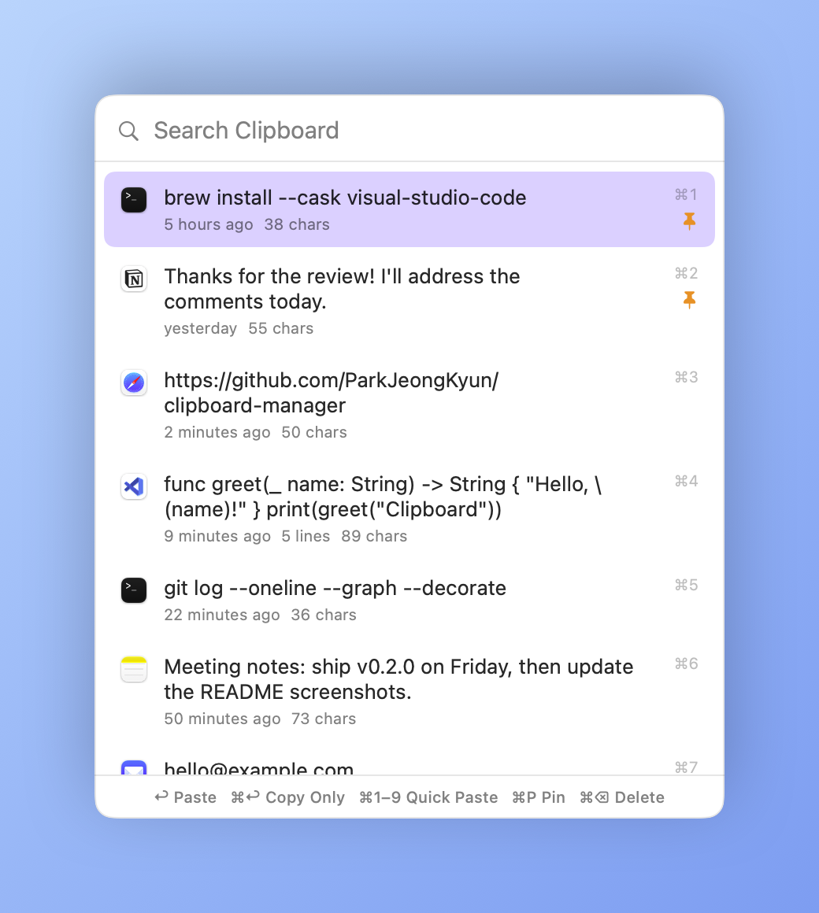

# Clipboard Manager

A lightweight macOS clipboard history app that lives in the menu bar, inspired by Windows' `Win + V`.
Press a shortcut, pick an item with the keyboard, and it is pasted straight into the app you were using.

<p align="center">
  <picture>
    <source media="(prefers-color-scheme: dark)" srcset="docs/images/quick-picker-dark.png">
    
  </picture>
</p>

## Features

- **Quick picker (`⌃⌘V`)**: a floating panel that opens near the mouse pointer (or text cursor, configurable) without stealing focus from the current app
- **Type to search**, arrow keys to move, `↩` to paste
- **Pinned items** stay at the top and are never trimmed
- **Duplicates are merged**: copying the same text again moves it to the top
- **Password safe**: items that password managers mark as concealed/transient are not recorded
- **Encrypted history**: stored with AES-GCM, key kept in the Keychain
- **History window** to browse, search and preview full content
- Settings: language (English / 한국어), quick picker position (text cursor / mouse pointer / screen center), launch at login
- **Updates**: checks GitHub Releases once a day and updates in place (download → checksum → signature/version check → replace → relaunch). Automatic install is optional.

## Shortcuts

| Where | Key | Action |
|---|---|---|
| Anywhere | `⌃⌘V` | Open / close the quick picker |
| Quick picker | `↑` `↓` / `PageUp` `PageDown` | Move selection |
| | `↩` | Paste selected item |
| | `⌘↩` | Copy only (don't paste) |
| | `⌘1` – `⌘9` | Paste the Nth item |
| | `⌘P` | Pin / unpin |
| | `⌘⌫` | Delete |
| | `esc` | Clear search, then close |
| History window | double-click / `↩` | Copy |
| | `⌫` | Delete |

Auto-paste needs **Accessibility** permission (System Settings → Privacy & Security → Accessibility).
Without it, items are still copied to the clipboard.

## Install

**One-line install (recommended)** — installs the latest release into `Applications` and launches it, with no Gatekeeper warning. Run it again to update.

```sh
curl -fsSL https://raw.githubusercontent.com/ParkJeongKyun/clipboard-manager/main/install.sh | bash
```

**DMG** — download `ClipboardManager.dmg` from [Releases](https://github.com/ParkJeongKyun/clipboard-manager/releases/latest), open it and double-click the app:
it installs itself into `Applications`, ejects the DMG and relaunches (dragging it into `Applications` works too).
The app is not notarized, so the first launch is blocked once: click **Done**, then open
**System Settings → Privacy & Security** and click **Open Anyway**.
Run from Downloads it also installs itself into `Applications`.
Auto-paste needs Accessibility permission. Because the app is ad-hoc signed, macOS treats each new build as a different app:
if paste stops working after an update, remove ClipboardManager from the Accessibility list with − and allow it again.

Requires macOS 15+ (Apple Silicon and Intel). On first launch the Settings window opens; the shortcut is `⌃⌘V`.

## Development

Requires Xcode 16+ (Swift 6). Run `make` to list commands.

```sh
make install   # build, install to ~/Applications and launch (everyday use)
make run       # build and launch from build/ without installing
make test      # run tests
make check-l10n  # check for missing translations
make screenshots # regenerate README screenshots (docs/images)
make icon      # regenerate the app icon
make dist      # release files in build/: universal zip, dmg, SHA256SUMS
```

Ad-hoc signed builds change signature on every build, so macOS asks for Accessibility permission again.
To keep the permission between builds, sign with a fixed certificate:

```sh
SIGN_IDENTITY="Apple Development: Your Name (XXXXXXXXXX)" make install
```

## Release

```sh
make release VERSION=2.1.0
```

Bumps the version in `Resources/Info.plist`, runs tests, commits, tags `v2.1.0`, and (after confirmation) pushes.
The tag triggers GitHub Actions, which builds a universal app and publishes `ClipboardManager.zip`, `ClipboardManager.dmg` and `SHA256SUMS` to GitHub Releases.
Asset names have no version number, so `install.sh` always fetches the latest release from the same URL.

```
Sources/ClipboardManager/
  App/          App entry, menu bar scene, global shortcut
  Model/        ClipboardItem, ClipboardStore (single source of truth)
  Services/     Pasteboard watcher, paste (⌘V), encrypted persistence, caret lookup
  UI/           Quick picker panel, history window, menu bar menu
```

## License

[MIT](LICENSE)
